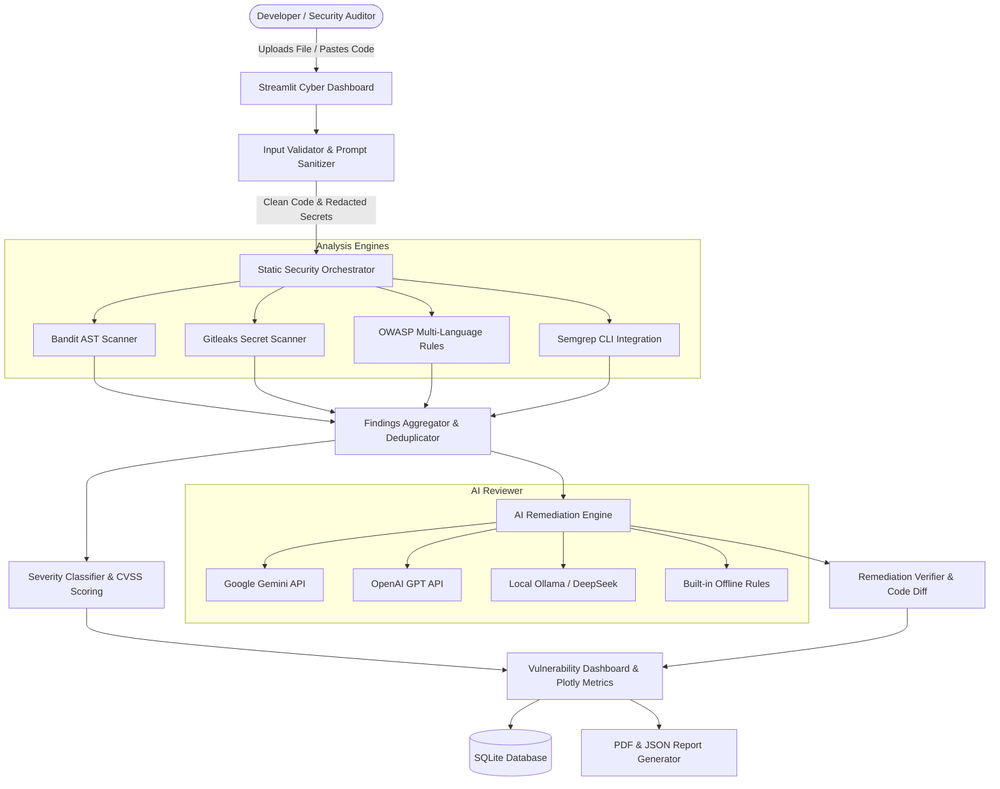

# 🛡️ AI-Assisted Secure Code Reviewer

An industry-grade, automated Application Security Testing (SAST) and AI-assisted code review platform. The system ingests source code across multiple languages, statically detects security vulnerabilities and exposed secrets, explains exploit mechanisms through an LLM engine, provides verified remediation patches with unified diff comparisons, computes an overall Security Score (0–100), and generates professional PDF & JSON audit reports.

---

## 🌟 Key Features

- **Multi-Engine Static Security Analysis**:
  - **Bandit AST Scanner**: Deep semantic AST scanning for Python dangerous function calls, unsafe deserialization, shell escapes, and misconfigurations.
  - **Gitleaks-Grade Secret Engine**: Scans for AWS access keys, GitHub tokens, Slack webhooks, database credentials, private RSA/EC keys, and high-entropy secrets.
  - **OWASP Multi-Language Rules**: Extensible pattern engine covering SQL Injection, OS Command Injection, XSS, Path Traversal, SSRF, Broken Cryptography, and Insecure Deserialization in Python, JavaScript/TypeScript, Java, C/C++, PHP, Go, and SQL.
  - **Semgrep CLI Integration**: Seamless hooks for enterprise Semgrep rulesets.
- **Provider-Agnostic AI Engine**:
  - **Google Gemini API** (`gemini-1.5-flash` / `gemini-1.5-pro`)
  - **OpenAI API** (`gpt-4o`, `gpt-4o-mini`)
  - **Local LLM via Ollama** (100% offline & private scanning with `deepseek-coder`, `codellama`, or `llama3`)
  - **Built-in Offline Intelligence**: Zero-dependency rule-based security explanations when operating without external cloud API access.
- **Enterprise Security Posture & Guardrails**:
  - **Sandboxed Analysis**: Source files are inspected as text streams and parsed into Abstract Syntax Trees—**never executed**.
  - **Zero-Knowledge Secret Redaction**: Credentials and tokens are automatically masked via regex heuristics before any source code reaches an external LLM.
  - **Prompt Injection Defense**: Strips jailbreak attempts, delimiter hijacking, and prompt extraction strings embedded in comments or strings.
- **Interactive Remediation & Verification**:
  - Side-by-side and unified diff viewer highlighting exact additions and removals.
  - Automated syntax checking and post-fix regression rescanning to verify vulnerability resolution.
- **Executive Reporting & Review History**:
  - Export audit findings as branded **PDF Reports** with severity breakdowns, impact assessments, and code snippets.
  - Machine-readable **JSON reports** for CI/CD integration.
  - SQLite database tracking audit history, security metrics, and remediation trends.

---

## 📐 System Architecture



---

## 🗂️ Project Structure

```
AI-Secure-Code-Reviewer/
├── app.py                     # Streamlit Main Cyber Dashboard
├── config.py                  # System Configuration, CVSS Weights, OWASP Mapping
├── requirements.txt           # Python Dependencies
├── .env.example               # Template Environment Variables
├── README.md                  # Comprehensive Documentation
│
├── modules/
│   ├── code_upload.py         # File ingestion, samples & paste handlers
│   ├── input_validator.py     # Binary check, prompt injection defense, secret redaction
│   ├── static_analyzer.py     # Orchestrator aggregating all scanner findings
│   ├── ai_reviewer.py         # Flexible AI Review Engine (Gemini, OpenAI, Ollama, Offline)
│   ├── severity_classifier.py # OWASP/CWE classification & Security Score (0-100)
│   ├── fix_recommender.py     # Unified diff generation & automated fix verification
│   ├── report_generator.py    # Professional PDF and JSON export engine
│   └── database.py            # SQLite schema, review logs, and audit trail
│
├── scanners/
│   ├── bandit_scanner.py      # Bandit Python AST security scanner
│   ├── secret_scanner.py      # High-entropy & regex secret scanner (AWS, JWT, GitHub, DB URIs)
│   ├── custom_rules.py        # Multi-language vulnerability rule engine (Python, JS, Java, etc.)
│   └── semgrep_scanner.py     # Semgrep CLI wrapper with fallback
│
├── sample_code/
│   ├── vulnerable_python.py   # SQLi, Command Injection, AWS Key, Insecure Pickle, MD5
│   ├── secure_python.py       # Parameterized queries, safe subprocess, env keys
│   ├── vulnerable_js.js       # XSS (innerHTML), eval(), exposed tokens
│   └── vulnerable_java.java   # Dynamic SQL, hardcoded credentials, weak MD5
│
└── tests/
    ├── test_validator.py      # Tests for validation, binary rejection & prompt sanitization
    ├── test_scanners.py       # Tests for Bandit, secret scanning, and scoring logic
    └── test_database.py       # Tests for SQLite persistence and review history
```

---

## 🚀 Quick Start Guide

### 1. Prerequisites
- Python 3.10+ (Tested on Python 3.12)
- Git

### 2. Clone Repository & Install Dependencies
```bash
git clone https://github.com/your-username/AI-Secure-Code-Reviewer.git
cd AI-Secure-Code-Reviewer

# Create and activate virtual environment
python -m venv venv
# Windows:
venv\Scripts\activate
# Linux/macOS:
source venv/bin/activate

# Install requirements
pip install -r requirements.txt
```

### 3. Configure Environment Variables (Optional)
Copy the example environment configuration:
```bash
cp .env.example .env
```
Edit `.env` to configure your preferred AI provider:
- **Google Gemini**: Set `GEMINI_API_KEY=your_key_here` and `AI_PROVIDER=gemini`
- **OpenAI**: Set `OPENAI_API_KEY=your_key_here` and `AI_PROVIDER=openai`
- **Ollama**: Set `AI_PROVIDER=ollama` and `OLLAMA_MODEL=deepseek-coder:6.7b`
- **Offline Mode**: Leave keys blank; the system will automatically utilize its high-fidelity offline engine!

### 4. Run the Application
Launch the Streamlit cyber dashboard:
```bash
streamlit run app.py
```
Open your browser at `http://localhost:8501`.

---

## 🧪 Running Automated Tests

Run the full unit test suite:
```bash
python -m unittest discover tests
```
All 12 test cases will run against the validator, scanners, and database modules.

---

## 📊 Security Score Calculation Formula

The application scores code from **0 to 100 points**:

$$\text{Raw Score} = 100 - (N_{\text{crit}} \times 25 + N_{\text{high}} \times 15 + N_{\text{med}} \times 7 + N_{\text{low}} \times 2)$$

- **Risk Capping**: If any **Critical** vulnerability is present, the final score is capped at **$\le 45$ (Grade D/F)**, preventing insecure code from passing deployment thresholds.
- **Letter Grades**:
  - **A (90–100)**: Clean / Secure baseline
  - **B (75–89)**: Good, minor informational findings
  - **C (60–74)**: Moderate Risk
  - **D (40–59)**: High Risk
  - **F (0–39)**: Critical Risk – Immediate remediation required

---

## 🛡️ OWASP Top 10 Coverage Matrix

| Category | CWE | Description | Detection Engine |
| :--- | :--- | :--- | :--- |
| **A01: Broken Access Control** | CWE-22 | Path Traversal / Arbitrary File Read | Custom Rule + Bandit |
| **A02: Cryptographic Failures** | CWE-328 / CWE-798 | MD5/SHA-1 usage & Hardcoded Credentials | Custom Rule + Secret Scanner |
| **A03: Injection** | CWE-89 | SQL Injection (Dynamic concatenation) | Custom Rule + Bandit |
| **A03: Injection** | CWE-78 | OS Command Injection (`shell=True`, `exec()`) | Bandit + Custom Rule |
| **A03: Injection** | CWE-79 | Cross-Site Scripting (XSS via `innerHTML`) | Custom Rule Engine |
| **A05: Security Misconfiguration**| CWE-215 | Debug mode enabled in production | Custom Rule + Bandit |
| **A08: Integrity Failures** | CWE-502 | Insecure Deserialization (`pickle.loads`) | Bandit + Custom Rule |
| **A10: SSRF** | CWE-918 | Unvalidated outbound HTTP requests | Custom Rule Engine |

---

## 💼 Technical Interview & Portfolio Highlights

- **Full-Stack Application Security**: Integrates compiler AST concepts (Bandit AST parsing), regular expression state machines, and LLMs.
- **Defense-in-Depth for AI**: Solves data privacy in AI workflows by redacting secrets locally before sending context to external APIs, and sanitizing untrusted inputs against prompt injection attacks.
- **Automated Verification**: Doesn't just generate LLM suggestions—verifies syntax correctness and calculates the quantifiable score delta before and after remediation.
- **Enterprise Reporting**: Outputs compliance-ready PDF and JSON artifacts suitable for developer handoffs and DevSecOps pipelines.

---

## 📄 License

This project is licensed under the Apache 2.0 License.
